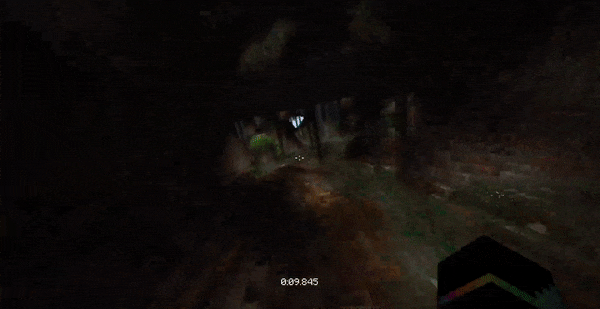

# <p align=center style="text-align: center;">  </p>

<p align="center" style="text-align: center;">
	
	
	
</p>

<p align="center" style="text-align: center;">
	
	
</p>

<p align="center" style="text-align: center;">
	<a alt="Buy Me a Coffee" href="https://buymeacoffee.com/aspctt"></a>
</p>

<p align="center" style="text-align: center;">
	<a alt="Available on GitHub" href="https://github.com/aspctt/do-a-barrel-roll-neoforge"></a>
	<a alt="Available on Modrinth" href="https://modrinth.com/mod/do-another-barrel-roll"></a>
	<a alt="Available on CurseForge" href="https://www.curseforge.com/minecraft/mc-mods/do-another-barrel-roll"></a>
</p>

## Description

**Do Another Barrel Roll is a native NeoForge port of [enjarai's Do a Barrel Roll](https://github.com/enjarai/do-a-barrel-roll).**

Do a Barrel Roll unlocks the camera during elytra flight. Moving the mouse sideways rolls you and moving it up and down pitches you, while A and D yaw. Rolling to one side also turns you toward it, which the mod calls banking, and camera smoothing takes the edge off sharp inputs.

Upstream ships a NeoForge build of its own, but it is made from a multiloader template and runs on the Forgified Fabric API, which has to be installed alongside it. This port is written against NeoForge directly, so it needs no Fabric API, Forgified Fabric API, CICADA, Mod Menu or Fabric permissions API. It uses Mojang mappings throughout and hooks into NeoForge's own events wherever NeoForge has one.

Configs, keybinds, permission nodes and the server handshake all keep their original names, so an existing `do_a_barrel_roll-client.json` or `do_a_barrel_roll-server.json` carries over untouched.


## Controls

The mouse handles roll and pitch, while A and D yaw. The I key turns the mod on and off, and the config can swap roll with yaw or invert pitch.

Every key can be rebound in the controls menu. The flight keys sit in their own key conflict context and only work while you are flying, so yaw can share A and D with strafing without the menu marking them as a conflict.

## Configuration

Install [YACL](https://modrinth.com/mod/yacl) and the config screen opens from the Config button next to the mod in NeoForge's mod list, or from a key you bind yourself. Without YACL the mod runs the same, and the button offers to open YACL's download page instead.

The options cover sensitivity and smoothing per axis, banking strength, automatic righting, a momentum-based mouse mode, a horizon widget and how the elytra activates. Triple Jump, for example, takes two jumps in the air instead of one, so sprint jumping stops opening your elytra by accident.

## Server-side features

Installed on the server as well, the mod syncs each player's roll so others can see it. Vanilla clients and vanilla servers stay compatible in every combination. A vanilla client joins a modded server and plays normally without seeing anyone roll, and a modded client on a vanilla server sees only its own roll. In short, you see another player roll only when you, they and the server all have the mod.



## Installation

Drop the jar for your Minecraft version into your `mods` folder. Nothing else is required.

| Minecraft | NeoForge | YACL, optional |
| --- | --- | --- |
| 1.21.1 | 21.1.217 or newer | 3.6.0 or newer |
| 1.21.11 | 21.11.45 or newer | 3.8.1 or newer |
| 26.1, 26.1.1, 26.1.2 | 26.1.0.19-beta or newer | 3.9.5 or newer |
| 26.2 | 26.2.0.76 or newer | 3.9.5 or newer |
| 26.3 | 26.3.0.12-beta or newer | 3.9.7 or newer |

The 26.1 jar covers 26.1, 26.1.1 and 26.1.2.

## Anticheat

Thrusting aside, the mod does not change the flight physics, so most anticheats have nothing to catch. Loops and fast rolls still look like very rapid camera movement to the server, though, and some anticheats flag that. Use it at your own risk.

## For server admins

### Thrusting

Thrusting lets a player accelerate by holding W in flight, without using fireworks. Most servers would call that cheating, so it stays off until the server allows it, and each player also has to turn on Enable Thrusting in their own config.

To allow it, install the mod on the server and turn it on in the Server tab of the config screen. The tab only shows for level 3 operators and players with the `do_a_barrel_roll.configure` permission. You can also set `allowThrusting` in `config/do_a_barrel_roll-server.json`, which needs no client at all.

Players who only want thrusting can turn on Thrust While Disabled in their own config and switch the rest of the mod off. They then fly with the vanilla controls and thrust with W, and the server still has to allow it.

### Server config

`config/do_a_barrel_roll-server.json` holds these settings, and the Server tab edits the same ones:

- `allowThrusting`: Lets players thrust. Off by default.
- `forceEnabled`: Keeps the mod on for every player, whatever their client config says.
- `forceInstalled`: Kicks anyone who joins without the mod.
- `installedTimeout`: How many ticks the server waits for a client to answer the config sync before `forceInstalled` kicks it. The default is 40, which is two seconds. Raise it if players on slow connections get kicked despite having the mod.
- `kineticDamage`: What hitting a wall in flight does. `VANILLA` is the default, `HIGH_SPEED` only hurts at much higher speeds, `NONE` turns it off and `INSTANT_KILL` does what it says.
- `operatorBypass`: Lets level 2 operators and players with the `do_a_barrel_roll.ignore_config` permission ignore `allowThrusting` and `forceEnabled`. Off by default.

Both permission nodes are registered with NeoForge's permission API, so any permission handler mod can grant them. `operatorBypass` is new in this port. Upstream documented the bypass but never applied it, so it starts off and servers keep behaving as they always have until an admin turns it on.

A server that cannot run the mod can still send these settings. Send a packet to the client at login on the `do_a_barrel_roll:config_sync` channel and it replies on `do_a_barrel_roll:config_response`. The payload layout matches upstream's protocol version 4.

## Differences from upstream

Flying works the same as upstream, and most of what changed is out of sight.

- Thrust While Disabled is new. It keeps thrusting working with the rest of the mod turned off, for players who prefer the vanilla controls.
- Controller support, the Mod Menu search easter egg and CICADA's update notices are gone. All three rely on Fabric-only code and were already missing from upstream's NeoForge build. The controller sensitivity settings stay in the config for anything else that drives the roll API.
- The serverbound roll packet moved to `do_a_barrel_roll:roll_sync_c2s`, since NeoForge allows one payload per channel id rather than one per direction. The clientbound one keeps its original name.
- Kinetic damage is applied through NeoForge's incoming damage event rather than by rewriting a local variable inside `LivingEntity.travel`.
- Camera roll, the crosshair widgets, the Peppy overlay and the F3 roll readout all go through NeoForge events instead of mixins.
- On 1.21.11 and newer the F3 roll readout gets a line of its own rather than joining the facing line. Those versions turned the debug screen into a registry of entries that can only add lines.
- Lang files are JSON rather than the YAML upstream compiles with yamlang.

## Building

All five Minecraft versions are built from one source tree with [Stonecutter](https://stonecutter.kikugie.dev/). Each target is declared in [settings.gradle.kts](./settings.gradle.kts), with its Minecraft, NeoForge and YACL versions in `versions/<target>/gradle.properties`.

```bash
./gradlew buildAll
```

That writes one jar per target under `versions/<target>/build/libs/`. To work on a single version, run `./gradlew "26.2:build"`, or switch the source tree over with the "Set active project to <target>" tasks so the IDE resolves against that version. Run `Reset active project` before committing, so the tree goes back to 1.21.1.

Version-specific code is marked inline with `//? if` comments, or handled as a rename in [stonecutter.gradle.kts](./stonecutter.gradle.kts) when nothing but a name changed.

### Checks

Two kinds of mistake compile cleanly and still fail in the game, so both are checked against the game's own bytecode with `javap`. CI runs them on every build.

- **Mixin targets.** A mixin names its targets in strings javac never looks at. `tools/check-mixin-targets.py` confirms every injected method, accessor and shadowed field or method still exists on each target with the types the mixin expects, and that each injection handler's arguments still match.
- **Older NeoForge builds.** A jar is compiled once, against one NeoForge build, but accepts older ones too. The 26.1 jar is built on 26.1.2 and also has to run on 26.1 and 26.1.1. `tools/check-linkage.py` reads every game method, field and class the jar uses and checks each one exists in the oldest build it accepts.

```bash
python tools/check-mixin-targets.py
./gradlew :26.1:writeCompileClasspath -Pneo_version=26.1.0.19-beta -Pminecraft_version=26.1
python tools/check-linkage.py 26.1 26.1.0.19-beta
python tools/check-mixin-targets.py 26.1 --neoforge 26.1.0.19-beta
```

Each NeoForge minimum in `versions/<target>/gradle.properties` is a build these checks have passed on. If you lower one, run the same checks against the new floor and add it to the list in `.github/workflows/build.yml`.

### Releasing

`./gradlew publishMods` uploads every target with its sources jar to Modrinth and CurseForge, and creates one GitHub release for the version with the main jars attached, using [mod-publish-plugin](https://modmuss50.github.io/mod-publish-plugin/). Each platform gets the targets one at a time, from the oldest Minecraft version to the newest. The notes come from the version's section of `CHANGELOG.md`, and the portals list each jar for the Minecraft versions in `release_minecraft_versions`.

Releases normally go out through the Release workflow, started by hand from the Actions tab. Push the version's tag first, since the workflow stops unless the tag exists and marks the commit it is building. It takes two tokens from the repository's Actions secrets. `MODRINTH_TOKEN` is a Modrinth personal access token that can create, read and write versions, and `CURSEFORGE_TOKEN` is a CurseForge API token. GitHub uses the workflow's own token.

Ticking "dry run" builds everything and uploads nothing. The files it would have sent stay on the runner, so read them from a local dry run instead.

To publish from a local machine, set those two tokens and a `GITHUB_TOKEN` that can write the repository's contents as environment variables, then run `./gradlew publishMods`. With any of the three missing the run is a dry run, which uploads nothing and writes what it would have sent under each project's `build/publishMods`.

## Credits

Do a Barrel Roll is by [enjarai](https://github.com/enjarai), based on the [Cool Elytra Roll](https://github.com/Jorbon/cool_elytra) mod by [Jorbon](https://github.com/Jorbon), specifically its "realistic mode". Originally ported to Forge by [MehVahdJukaar](https://github.com/MehVahdJukaar).

Mod icon by Mizeno.

Native NeoForge port by aspctt.

## Licensing

GPL-3.0-only, the same licence as upstream. The full terms are in [LICENSE](./LICENSE).
